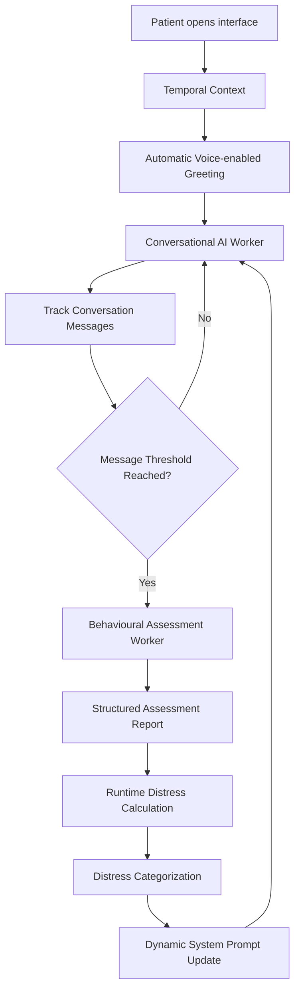
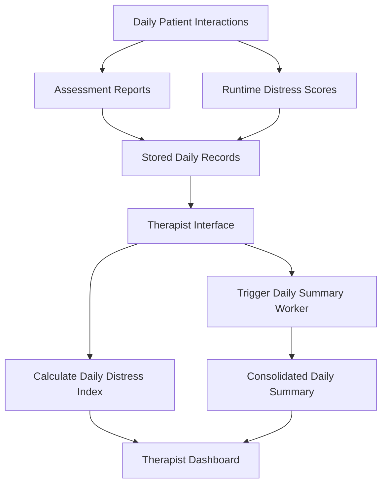

# SafeMind

**An offline-first, custom event-driven multi-worker AI system for continuous mental well-being monitoring and therapist support.**

SafeMind explores how AI can help bridge the gap between periodic therapist sessions and the emotional fluctuations a patient may experience throughout the day.

Traditional therapist sessions capture a patient's emotional state at a particular point in time. However, emotional states can change throughout the day, and those changes may not always be reflected during scheduled sessions.

SafeMind addresses this by combining proactive conversational interaction, automated behavioural assessments, adaptive AI responses and daily therapist-facing summaries.

---

## Overview

SafeMind is built around three independently prompted AI workers that operate within a custom event-driven architecture.

The system provides two interfaces:

- **Patient Interface:** A private conversational environment where patients can interact with an AI companion through text and voice.
- **Therapist Interface:** A monitoring dashboard that provides aggregated distress information and AI-generated summaries of the patient's daily interactions.

The architecture is designed around a centralized hospital infrastructure where multiple patient nodes communicate with a shared server over the hospital's local network.

The hackathon implementation demonstrates the complete workflow using one patient node connected to the therapist interface.

## Architecture

SafeMind consists of three primary AI workers.

### 1. Conversational AI Worker

The primary conversational worker handles patient interactions.

Its responsibilities include:

- Initiating conversations automatically when the patient opens the interface.
- Generating time-aware greetings based on temporal context.
- Conducting contextual emotional check-ins.
- Supporting both text and voice-based interactions.
- Maintaining conversational context.
- Dynamically adapting its conversational behaviour based on the current distress category.

The conversational worker does not operate with a permanently fixed system prompt. Its instructions are updated according to the runtime distress category calculated by the assessment pipeline.

### 2. Behavioural Assessment AI Worker

The second worker performs contextual behavioural assessments.

It is triggered when the conversation reaches a predefined message threshold.

Upon activation, it independently queries the local LLM server using a separate prompt and processes the accumulated conversation batch.

It generates structured assessment reports containing possible indicators such as:

- Anxiety
- Fear
- Sleep difficulties
- Hopelessness
- Other distress-related signals

Each indicator receives an estimated score between 0 and 100.

These assessments are subsequently processed by the runtime distress calculation mechanism.

#### Runtime Distress Calculation

The system extracts the indicator scores from the generated assessment and calculates an aggregate runtime distress score.

The resulting score is classified into one of four predefined distress categories.

These categories drive dynamic system prompt adaptation in the primary conversational worker.

As the estimated distress category increases, the conversational agent adjusts its behaviour to become more attentive and supportive, with greater emphasis on appropriate grounding exercises.

This creates a feedback loop between behavioural assessment and conversational interaction.

### 3. Daily Summary AI Worker

The third worker handles daily assessment summarization.

Throughout the day, multiple conversations, behavioural assessment reports and runtime distress scores are accumulated.

The therapist interface can request the patient's daily data, triggering the daily summary worker.

This worker processes the collected assessment reports and generates a consolidated summary highlighting:

- Recurring behavioural indicators.
- Notable observations.
- Indicators with comparatively higher estimated scores.
- Patterns observed across the collected assessments.

Alongside this qualitative summary, the system calculates a **Daily Distress Index** by aggregating the runtime distress scores recorded throughout the day.

The therapist receives both quantitative and qualitative information through the therapist interface.

---

## System Workflow

The following diagram illustrates the primary patient-side assessment and adaptation pipeline.

The daily therapist-side workflow:

---

## Technical Stack

| Component | Technology |
|---|---|
| Backend | Python |
| Backend Framework | FastAPI |
| Local LLM Inference | Ollama |
| LLM | Gemma |
| Speech-to-Text | Faster-Whisper |
| Voice Activity Detection | Silero VAD |
| Text-to-Speech | Kokoro TTS |
| Database | SQLite |
| Communication | HTTP / WebSockets |
| Frontend | Web-based patient and therapist interfaces |

### Architectural Concepts

- Custom event-driven multi-worker orchestration.
- Independent AI worker execution and prompting.
- Temporal-context-aware interaction initiation.
- Dynamic system prompt adaptation.
- Runtime distress calculation and categorization.
- Structured behavioural assessment generation.
- Daily data aggregation and summarization.
- Locally hosted AI inference and voice processing.

---

## Deployment Architecture

SafeMind is designed for deployment within a shared hospital network.

The proposed infrastructure consists of:

- A centralized server hosting the backend and AI processing infrastructure.
- Multiple patient nodes connected through the hospital's local network.
- Therapist-facing interfaces accessing patient assessment data through the centralized server.

The current implementation demonstrates this architecture using one complete patient node connected to the therapist interface through the server.

The AI inference and speech-processing stack currently runs locally, without depending on external cloud AI APIs.

---

## Future Improvements

The following extensions were identified but not fully implemented within the hackathon timeframe:

- **Early Distress Live Alert Subsystem:** Detect potentially concerning patterns and provide earlier notifications to therapists.
- **Multi-Patient Deployment:** Extend the demonstrated single-patient workflow to support multiple patient nodes.
- **Longitudinal Analysis:** Explore trends across multiple days to provide a broader view of changes in estimated distress indicators.

---

## Important Disclaimer

SafeMind is an experimental hackathon prototype exploring AI-assisted behavioural assessment and therapist support.

The generated assessments and distress scores are model-generated estimates, not clinically validated measurements or medical diagnoses.

The system is not intended to replace professional mental health evaluation, diagnosis or treatment.

---

## Acknowledgements

Developed as a project for a **Hackathon** btw.

